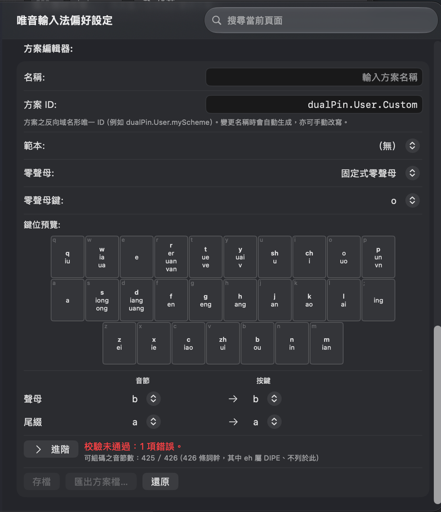

# 雙拼方案編輯器

> 本文的原始 markdown 可以[點此存取](https://raw.githubusercontent.com/vChewing/vChewing.github.io/refs/heads/main/manual/dualpinSchemaEditor.md)，以便使用者轉交給各種 AI 服務代為閱讀講解。

本文對應至少唯音輸入法 4.9.2 版。文中所述之編輯器位於「偏好設定 → 鍵盤設定」頁面的「雙拼方案」區塊底端；SwiftUI 偏好設定介面需 macOS 14 以上，舊版 AppKit 介面的同名區塊外觀不同、**功能一致**。

- [雙拼方案編輯器](#雙拼方案編輯器)
	- [雙拼與本編輯器](#雙拼與本編輯器)
	- [匯入既有的方案檔](#匯入既有的方案檔)
	- [方案編輯器各欄位](#方案編輯器各欄位)
	- [校驗報告](#校驗報告)
	- [存檔匯出與還原](#存檔匯出與還原)
	- [舊版系統之差異](#舊版系統之差異)
	- [方案檔何處尋](#方案檔何處尋)

## 雙拼與本編輯器

「雙拼」是將每個漢字音節拆成「聲母 + 尾綴」兩段、各敲一鍵的拼音打法（兩鍵一音節）。同一音節在不同方案當中所對應的按鍵並不一樣，故各家雙拼互不相通：微軟雙拼、自然碼、四通、拼音加加……各是一套「音節 → 按鍵」的對照表。

唯音**內建**的雙拼方案只有兩套：

- **微軟雙拼**（預設）；
- **GB/T 34947-2017**（官標之雙拼方案）。

其餘已知方案（智能 ABC、拼音加加、搜狗雙拼、紫光華宇、自然雙拼 (周志農)、小鶴雙拼、四通雙拼等）以 JSON 方案檔的形式散布、由使用者自行匯入。**方案編輯器**就是「自備方案」的編輯工具：既能從既有方案出發改鍵位，也能從空白表開始逐一指定。

> 若您只是想用某一套現成的雙拼方案，請直接[匯入該方案檔](#匯入既有的方案檔)即可，無需動用編輯器。

## 匯入既有的方案檔

於「雙拼方案」區塊按「**匯入雙拼方案…**」，選取一個 JSON 方案檔（上限 1 MiB）：

- 匯入之方案會**整份取代**目前的「自訂雙拼」方案；「雙拼方案」下拉選單亦隨之切換為該方案（自訂項）。
- 匯入成功後會自動開啟「**啟用雙拼**」。
- 匯入之檔案會先經引擎校驗；若有錯誤，匯入會被拒絕、狀態列列出原因，原有的自訂方案不受影響。

> 註：方案檔一律以 UTF-8 JSON 撰寫；檔名不拘，但引擎只認檔案**內容**。多份方案檔之間請以各自的「方案 ID」區分。

## 方案編輯器各欄位

| 欄位 | 說明 |
| - | - |
| **名稱** | 方案之顯示名稱（上限 32 個字元）。存檔後會出現在「雙拼方案」下拉選單的自訂項上。 |
| **方案 ID** | 方案之反向域名形唯一 ID（例如 `dualPin.User.myScheme`）。預設依「名稱」自動生成（小寫、非英數字元改成 `-`），亦可手動改寫；手動改寫後即不再自動連動。方案 ID 不得與現存方案相衝、亦必須是反向域名形，否則[校驗報告](#校驗報告)會報錯。 |
| **範本** | `（無）` / `微軟雙拼` / `GB/T 34947-2017` / `目前自訂方案`。選定範本會**整份覆寫**當前的兩張表與零聲母政策（覆寫前會先確認，取消則退回原選項）。 |
| **零聲母** | 沒有聲母的音節（阿、鵝、歐……）之打法。三種政策：`固定式零聲母`（搭配下方的「零聲母鍵」，例如 `o`）、`母音第一個字元的按鍵`、`母音第一個字元的按鍵（2 個字元的母音是完整拼音）`。後兩者見於微軟雙拼一類方案。 |
| **鍵位預覽** | 26 個字母鍵與 `;` 的鍵位格。每格左上角小字為鍵名，其下逐行列出該鍵所代表的**聲母**（半粗體）與**尾綴**。 |
| **聲母／尾綴列** | 「音節」下拉選一個音節、「按鍵」下拉選一個鍵，指定即時生效；已被他處佔用的鍵會標示「已由 X 佔用」（同一鍵仍可同時兼作一聲母與一尾綴，此為常態）。 |

**欲另存內建方案為自訂方案**時，請把「範本」選為該內建方案：兩張表會整份拷貝過來，名稱留空供您填寫，方案 ID 亦自動重發為 `dualPin.User.<名稱>`——**內建方案本體不會被改寫**。

鍵位格上的底色為提醒，不影響存檔與否：

- 該鍵的碼未被任何音節用到（引擎之 W5）；
- 該鍵屬於系統保留鍵（引擎之 W3；唯音的保留鍵為 `` ` ``、`~`、`¥`、`\`）。

> 有些方案的 `ing` 落在 `;` 鍵（搜狗雙拼、紫光華宇、四通雙拼等），故其鍵位表共有 27 鍵；行動裝置之鍵盤未必提供 `;`，這類方案在手機上請改用落在字母鍵的方案（例如小鶴雙拼、周志農自然雙拼）。

## 校驗報告

編輯器每次重繪都會即時校驗整份方案（以唯音引擎所收錄的 426 條拼音詞幹為基準），並在「鍵位預覽」下方顯示一行摘要：

- 「**校驗通過，可存檔。**」——此時「存檔」與「匯出方案檔…」皆可用。
- 「**校驗未通過：N 項錯誤。**」——此時兩者停用；請修正後再存檔。
- 「**可組碼之音節數：425 / 426（426 條詞幹，其中 eh 屬 DIPE、不列於此）**」——說明引擎能為多少條詞幹取到碼。

按「**進階**」可展開逐條清單：**E** 開頭者為錯誤（阻擋存檔）、**W** 開頭者為提醒（不阻擋）。常見者：

| 代碼 | 意義 | 處理 |
| - | - | - |
| E1 / E2 | 某音節之碼用到了鍵位表外的鍵，或碼的長度不對。 | 重新指定該音節之按鍵。 |
| E3 | 某詞幹取不到碼、且未列於 `acknowledgedUnreachable`。 | 補齊該音節之鍵位。 |
| E5 | 同一組碼同時對應兩個音節（例如別名與主碼相撞）。 | 改掉其中一個。 |
| E7 | 名稱（`rawTitle`）為空。 | 於「名稱」欄填寫。 |
| E9 | 方案 ID 為空、非反向域名形，或與現存方案相衝。 | 改用如 `dualPin.User.myScheme` 之 ID。 |
| W2 | 重碼：一組碼同時對應多個音節（`lo` 與 `luo` 一類同鍵之必然）。 | 通常無需處理；出現時請確認是否為該方案之固有設計。 |
| W5 | 兩表所給之鍵未被任何碼用到。 | 可刪去該鍵，或改用它。 |
| W8 | 缺少英文（`en`）標題。 | 若非散布之用，可忽略。 |

> 唯音引擎視 `eh`（孤立ㄝ）為「雙拼不可表達之拼音表示式」（DIPE）：既不列為錯誤、亦**不得**列入 `acknowledgedUnreachable`。這是因為漢語拼音方案之韻母表不含 ê、以通用鍵盤輸入時另作兩鍵 `EA`。任何雙拼方案都無法把 `eh` 排進兩鍵的格子內，故 426 條詞幹中永遠有一條無碼——這不是方案的缺陷。

## 存檔匯出與還原

| 動作 | 作用 |
| - | - |
| **存檔** | 於校驗通過時，把整份方案寫入唯音之偏好設定（`dualpinSchemaJSON`）並切換為「自訂雙拼」、同時開啟「啟用雙拼」。 |
| **匯出方案檔…** | 把當前草稿序列化為 JSON 檔案寫出（建議檔名為 `<名稱>.dualpin.json`）；內容與存檔所用者相同，可直接散布給他人匯入。 |
| **還原** | 丟棄尚未存檔的編輯，回復到偏好設定當中的現行方案。 |

存檔與匯出之成功／失敗皆顯示於編輯器底端的狀態列（例如「已存檔雙拼方案：…」「已匯出方案檔：…」）。

> 匯出之 JSON 之首行為 `$schema`（指向官網所附之 JSON Schema），其後依序為 `rawID`、`rawTitle`、`localizedTitle`、`initials`、`finals`、`nullOnset`、`keyInterception`、`autochopPolicy`，以及非空時之 `overrides`、`aliases`、`acknowledgedUnreachable`。以縮排 2 空格、鍵序固定之形式輸出，以便版本比對。

## 在舊版系統上的行為差異

macOS 10.12 與更早版本**無法使用系統的檔案面板**（輸入法自己的視窗呼叫這種 Modal FileImporter / Exporter 的話，會導致輸入法失去響應，連帶整個系統失去響應。），故唯音在 macOS 10.13 之前的系統上一律不開面板：

- 「**匯入雙拼方案…**」改為彈出說明視窗、請使用者改用較新之系統。
- 「**匯出方案檔…**」改為把方案檔傾印至 `~/Library/Application Support/fileDump/`，並於狀態列顯示實際路徑（該目錄會自動建立）。

macOS 10.13 至 10.13.1 可用系統檔案面板，但 `allowedContentTypes` 需 macOS 11 以上方能使用，唯音於該等系統改走 `allowedFileTypes` 之等價設定——使用者無需理會。

## 方案檔何處尋

- 唯音官網倉庫之方案定義檔（微軟雙拼與 GB/T 34947-2017 以外之已知方案、以及可直接用於驗證之 JSON Schema）：<https://github.com/vChewing/vChewing.github.io/tree/main/valueadd/dualpin-schema-files>
- 方案檔之格式標準（各欄位之意義、編組規則、校驗代碼一覽）：見《[唯音輸入法：雙拼方案定義檔格式標準](../techdocs/Dualpin_Schema.md)》。
- 亦可自其他輸入法之雙拼方案換算：只要備齊「聲母表」「尾綴表」與零聲母政策，即可在編輯器內逐一指定，或直接手寫 JSON。
