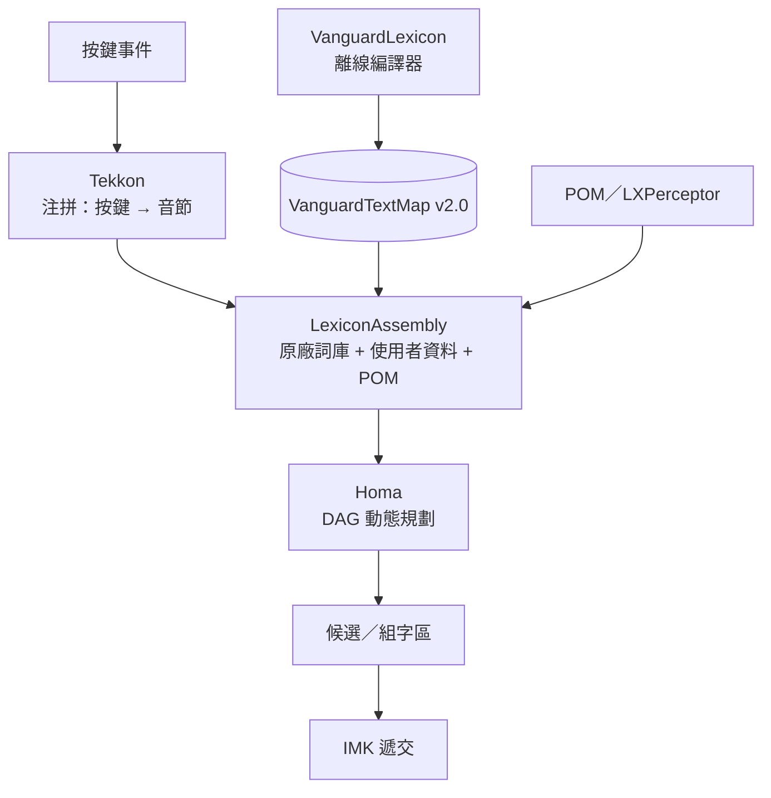
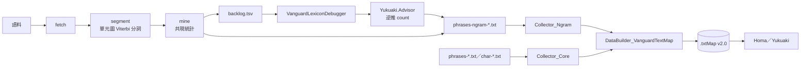

# 唯音輸入法（vChewing）三元圖架構白皮書 (2026-11-11)

| 項目 | 內容 |
|---|---|
| 版本範圍 | v4.1.3（2025-11-30）～ v5.0.1（2026-11-11，GM Build 5010） |
| 開發階段 | 2026-10-23 起約三週（語料側 n-gram 主線）；前置為 2026 年 8–9 月之 POM 供給 |
| 文件日期 | 2026-11-12 |
| 基準 | `vChewing-macOS` `5.0.1`／`vChewing-LibVanguard` `8923d9a`／`vChewing-VanguardLexicon` `a0a1b209` |
| 性質 | 架構說明（architecture note），非提案；所記之決策均已落地，或已明確標為未啟用／界線 |

## 背景

### 兩款產品，一個容易混淆的名字

唯音（vChewing）是 macOS 上的注音／拼音輸入法；酷音（Chewing，即新酷音）是另一款更具歷史悠久之產品，以 C 語言起家、歷經三代架構、目前已用 Rust 徹底重寫。這兩個產品在**程式碼上沒有上下游關係**：唯音不連結 `libchewing`、不以酷音的引擎組句，酷音也不消費唯音的程式碼；兩者各自有自己的引擎與詞庫管線。

唯一一次歷史交集在**詞庫建置**這一層：2022 年底唯音的前身（威注音）曾把自己定位為「給酷音引擎等幾款其他的 FOSS 中文輸入法另立一套原廠 lexicon 建置套件」——說的是供一份詞庫建置管線，建置原廠詞庫給某些 FOSS 輸入法使用（包括新酷音輸入法），而不是唯音的程式碼依附於酷音。英文名遂取作 vChewing，在 Chewing 之前冠一個前綴。這個名字此後沒有再改，但那個定位早已不成立：唯音現在有自己的引擎與詞庫編譯器；`vChewing-VanguardLexicon` 仍保留 `chewingCBased*` 與 `chewingRust*` 生成器，能產出酷音可讀的辭典檔，但那是詞庫建置管線的輸出，不是程式碼的傳承，也不是「唯音是酷音的詞庫」。名字留了下來，成為每一份對外說明都必須先解釋一次的東西。

本文所述的三元圖 (trigram) 架構屬唯音。凡提及酷音之處皆為對照，並會明寫「酷音」；凡引用酷音社群之文件（例如〈新酷音輸入法架構更新提案〉，2026-11-12 版）亦同。

> 在需要使用純中文的表述環境下，敝專案以 `三元圖` 代稱 `trigram`、以 `複元圖` 代稱 `ngram`。

### 詞頻是策展參數，不是樣本頻次

唯音的詞頻不是任何單一語料的樣本數。2022 年底的做法是把 NAER 的報刊、對話、國語教材等多個分類疊加，再整體施以對數曲線；此後數年，詞頻是逐詞、逐讀音依打字體驗手調的。因此：

- `phrases-*.txt`、`char-kanji-core.txt` 與 n-gram 表的數字是**策展權重**（curation knobs），不是出現次數。
- 為解決特定問題而手調 n-gram／unigram 的次數，是正當手段，不須語料背書。
- 仍須守兩條：**同一欄位語意一致**（第 2 欄恆為「該前文下該詞之權重」、第 5 欄恆為「該前文本身之權重」）；**可追溯**（手調列須在檔內註明其為手調與緣由）。

這件事決定了整個架構的取向。既然靜態分數不是正規化機率，就不能假設它「已經等於 P(w)」，也難以套用需要正規化假設的平滑法（Kneser-Ney、線性插值）——那些方法的前提在此不成立。唯音因此採用「加性對數 ＋ 相對增益 ＋ 閘門」的模型，而不是統計派的標準做法。這個取捨的好處與代價，見〈解碼器評分公式〉與〈已知界線〉。

### 一句話的管線

按鍵經 Tekkon 組成注音音節，LexiconAssembly 把原廠詞庫、使用者資料與 POM 合成候選元圖，Homa 在 DAG 上求最佳路徑，選字窗與組字區消費結果。本文談的是其中「分數從哪裡來」的那一段。

## 歷史沿革：從 unigram 到 sparse trigram

### 2002 年起的工業通用三層架構，與唯音的參照

2002 年酷音技術報告把系統分成使用者介面、斷詞、字詞庫三層，斷詞的本體是「在詞圖上找累計頻率最高的路徑」。這個三分並非酷音獨有；此後二十餘年，中文輸入法的骨架沒有變過：注音（或拼音、倉頡）→ 音節 → 詞圖 → 最優路徑。唯音的骨架在概念上與此相同（音節 → 詞圖 → 最優路徑），其早期的組句引擎 Megrez 亦循此形；但程式碼是獨立的：它不從酷音的分支長出來，也不共用其引擎；差別在每一層的邊界畫在哪裡、以及最優路徑的「分數」從哪裡來。

唯音的起點有二：

- 2021 年底的威注音語料庫專案（後稱「先鋒語料庫 VanguardLexicon」）；當時的自我定位是「給酷音引擎等幾款其他的 FOSS 中文輸入法另立一套原廠 lexicon 建置套件」，亦即詞庫建置管線與其產出的原廠詞庫，不是程式碼的上下游。
- 2022 年初的威注音輸入法。當年Q1剛問世時還是自小麥注音的分支專案，到當年Q3就已經全部用 Swift 重寫了（包括 Megrez 組句引擎、以及支援拼音注音排列方案最多的 Tekkon 注拼引擎）。

唯音專案的規劃始於 2025 年初開始內部開發的先鋒引擎專案（LibVanguard），這也是 ngram 組句引擎「Homa (護摩)」的起點。同年 11 月 30 日的 v4.1.3 是「唯音時代」的起點（也是威注音輸入法的終點）：此後開發以 LLM 輔助為主。LibVanguard 先鋒引擎套件連帶 Homa 組句引擎在 2026 年 4 月接手 macOS 版唯音輸入法的組句與打字任務調度等核心工作。到唯音輸入法 v5.0.1（2026-11-11），這條路走完了一輪：詞庫、引擎、資料格式、驗證工具全部自有。

### 2025：Homa 與 bigram 的空位

`vChewing-LibVanguard` 現存歷史上最早的一筆 Homa 提交在 2025-02-15，訊息是 "Initial implementation with limited Bigram support"。也就是說，bigram 從一開始就在資料模型裡（`Gram.previous`），但沒有資料：詞庫只出 unigram，bigram 只能由使用者的選字記憶（POM）臨時供給。

2025-11-30 的 v4.1.3 是這個狀態的定點：辭典側純 unigram、POM 以覆寫分數介入、TextMap 是 v1.1，型別 C 的第 4 欄只承載一個前詞。這一欄在格式上就宣告了上限：能表達 bigram，不能表達 trigram。

### 2026 年 8 月：把 POM 餵成 n-gram

2026-08-29 的一批提交是第一次認真的嘗試：Homa 的 `Gram` 增加 `anterior`、`getScore` 加入 trigram 計分；`TrieKit` 的 `Entry` 增加第 5 欄 `anterior`；POM 開始把記憶當 bigram 與 trigram 餵進引擎。這批改動隨 v4.7.0（2026-08-30）出貨；v4.7.3（2026-09-05）再把「POM 作為預設 n-gram 來源」打開。

這一輪的成果與限制都很清楚：引擎有了 trigram 的**形狀**，但語料側仍是空的。而第 5 欄是「多加一欄」，不是「一條鏈」——鏈長固定為二、同詞多前文時整列重複、也無法表達「前前詞是 `x`、前詞不限」這種稀疏情形（缺口列要到 2026 年 11 月才有）。真正的前驗詞鏈要等下一次改格式。

### 2026 年 10–11 月：原廠語料側的 trigram

主線集中在三週內完成。先立驗證路徑（`Yukuaki` 套件與 `VanguardLexiconDebugger` CLI），因為「資料不對時，得先能撇開審字因素、直接問該補什麼」；接著改格式、改解碼器；此後每一輪都有一條可量測的行為界線被推開：

| 日期 | 產出 |
|---|---|
| 10-23 | `Yukuaki`（輸入法無關的組句套件）＋ `VanguardLexiconDebugger` CLI；TextMap 2.0（前驗詞鏈、條件分數） |
| 10-24 | 正向文脈 DP；鏈長計次 `b + (k−1)(p−b)`；詞類模板 |
| 10-24 | POM 分數改為隨時間單調下探；語料挖掘器；節點保險單元圖 |
| 10-24／25 | TextMap 收束：型別 D 分組、嚴格載入、trigram 上限 |
| 10-25 | trigram 分母改為完整前文 `count(x, y)`；挖掘器之詞長預設與讀音誠實化 |
| 11-08 | 缺口列（`[x, *]`）；查詢契約（簡拼過濾、確定序）；使用者辭典之 `#NGRAM:` 列 |
| 11-08 | 匯出腳本分流；`make sort` 只重排資料列；逆推器列替代方案；資料檔改空白分欄 |
| 11-09 | TextMap 載入加速（bundled 檔略過逐行驗證）；術語定名：`Front Context`／正向文脈、`Rear Context`／負向文脈 |

其結果隨 v5.0.0（2026-11-09）出貨，同版另含 TextMap 載入加速與使用者自訂候選序（後者非 n-gram 主線，同期）。v5.0.1（2026-11-11）再收 2026-11-10 之手調 19 列與使用者資料寫入巷。

同期另有閂滯態之 `Shift+/` 寬度與選字窗格寬之調整；兩者與本文主題無直接關係。

### 版本對照

| 版本 | 日期 | 語言模型狀態 |
|---|---|---|
| v4.1.3 | 2025-11-30 | 辭典側 unigram；Megrez 組句；POM 覆寫；TextMap v1.1；型別 C 只有單一 `previous` |
| v4.7.0 | 2026-08-30 | POM 供 bigram／trigram；`Gram.anterior`；TextMap 第 5 欄 `anterior` |
| v4.7.3 | 2026-09-05 | POM 預設參與組句 |
| v4.9.2 | 2026-10-21 | 語料側 trigram 動工前夕 |
| v5.0.0 | 2026-11-09 | TextMap 2.0、正向文脈 DP、鏈長計次、缺口列、`#NGRAM`、完整前文分母、術語、載入加速、候選序 |
| v5.0.1 | 2026-11-11 | 手調 19 列原廠 NGram 資料 (其餘變更與 ngram 體系無關) |

v4.9.2 與 v5.0.0 之間沒有向使用者推送任何中間版本；TextMap 2.0 與其後的格式收束都在這段開發期內完成，第一個帶 TextMap 2.0 的出貨版是 v5.0.0。

## 截至 v4.9.2 時的問題

以下是截至該版（2026-10-21，主線動工前）的問題盤點；各條的對應處置見〈變更項目與理由〉，未解者見〈已知界線〉。

**辭典側只有 unigram。** 原廠詞庫的每一條詞都只有一個無條件分數；同音詞的取捨全靠詞頻與長度先驗。POM 能補一點語境，但那是「這個使用者最近選過什麼」，不是「這個詞在語言裡常跟誰一起出現」。

**格式只承載得了一個前詞。** TextMap v1.1 的型別 C 第四欄是 `previous`；v4.7.0 追加第五欄 `anterior` 之後，trigram 勉強有地方放，但鏈長固定、同詞多前文時整列重複，且無法表達缺口。

**組句 DP 的狀態只有位置。** `f(i) = max_j (f(j) + cost(j, i))` 只在「未來與過去條件獨立」時精確。n-gram 讓它不獨立：第 3 鍵的「在／再」取決於後面接的詞（「這樣」）——而那時它還沒被讀到。實測「你不要再這樣」：舊引擎給「在」——不是因為「再」的分數低，而是「再」那條路在第 3 鍵就被砍了；後面的「這樣」根本沒有機會替它辯護。

**節點在內部先定案。** 就算把前文塞進狀態，`Node.evaluate(previous:anterior:)` 仍只回傳唯一一條選中的元圖；「在」與「再」共用同一個 `ㄗㄞˋ` 節點，勝負在節點內部就分完了，DP 只拿到一個數字。

**POM 的分數方向是錯的。** 舊制 `score = −freqFactor × (1 − age/wT)² × 0.114514`：年齡核隨時間遞減，分數反而趨近 0（變強），越老的記憶越像語料統計；且硬截止處由 −0.0001 直落 −13.001。它與語料側的 log10 條件分數也不同源。

**使用者資料無法表達語境。** `userdata-*.txt` 只有 `值 讀音 [分數] [#標記]`；而匯出腳本只認前三格、一律當單元圖輸出——條件分數會被當無條件次數投餵進原廠詞庫。

另有三項不是 v4.9.2 的問題，而是 TextMap 2.0 與 n-gram 管線導入後才暴露的：節點無單元圖（第 10 項）、簡拼吃條件分數（第 9 項）、n-gram 資料檔與工具的沉默（第 11 項）。

## 目標

新的架構必須解決前述問題，並滿足以下設計目標。

**前文可變長，但止於兩層。** trigram 是上限（事主〔專案所有者〕裁定「ngram 最長定為 trigram」）。更長的鏈只存在於資料層與顧問工具，引擎不消費。

**解碼要精確，不要 beam。** 狀態數靠「相關值正規化」壓回 1——無 n-gram 資料時與舊 1D DP 完全等價；有資料時才分裂成多條假設。不引入近似搜尋。

**n-gram 只做相對增益。** 分數是加性對數；n-gram 不得覆寫單元圖、不得冒充無條件分數，候選須先過 `p > baseline` 的閘門。

**兩種契約分明。** 原廠詞庫嚴格（錯一列即拒，附行號）；使用者資料寬容（壞列只留診斷，絕不整體失敗）。這兩種契約刻意相反，見〈檔案格式與配置〉。

**可回答「為什麼」與「該補什麼」。** 給定讀音鏈能看組句結果；結果不對時，能在撇開審字因素的前提下反推「該補哪些 n-gram、補到多高的次數才會翻盤」。

**可重現。** 同一輸入 → 同一輸出；排序不得依賴 `Dictionary` 迭代序；詞庫重建須可逐位元組比對。

**詞頻是策展參數。** 不假裝是樣本頻次；手調列須可追溯、同一欄位語意一致。這條目標與上一條並不完全相容——策展參數改動即改變輸出——故「可重現」的範圍限定在「同一份資料與同一份程式」。

## 架構綜覽

### 模組

| 段 | 模組 | 職責 |
|---|---|---|
| 注拼 | `Tekkon` | 按鍵 → 注音音節；並擊、自動切音節、拼音與雙拼之前置轉換 |
| 辭典 | `VanguardTrie`／`TrieKit` | 讀音鍵 → 詞條；出貨格式為 `VanguardTextMap`（`.txtMap`），另有惰性 `TextMapTrie` |
| 辭典聚合 | `LexiconAssembly` | 原廠詞庫、使用者資料、POM 之合流；`LXFacade`／`LXQuerier`／`LXPerceptor` |
| 組句 | `Homa` | 依序插入讀音、建節點與幅節（segment：一次查詢所涵蓋的讀音段）、DAG 動態規劃、候選輪替與覆寫 |
| 宿主 | `vChewing-macOS` | IMK 回呼、組字區、選字窗、偏好；`LibVanguard` 以子套件鏡像 |

一句話：Tekkon 決定「有哪些音」，TrieKit 決定「每個音有哪些字」，LexiconAssembly 決定「這些字從哪裡來、彼此怎麼排」，Homa 決定「整句選哪一條路」。



### 離線與線上

離線側是詞庫編譯器：純文字詞表與 n-gram 表經 `Collector` 折算成權重，由 `DataBuilder_VanguardTextMap` 產出 `.txtMap`。線上側只有讀取：`.txtMap` 進 Trie，Trie 的詞條經 `LXFacade` 轉成 `Homa.Gram`，POM 的記憶在解碼期以同一種元圖追加。這條分界是「可重現」的基礎——靜態分數永遠與使用者狀態脫鉤。



### 兩個引擎

組句引擎有兩份實作，邏輯必須一致：

- `Homa`（護摩）——出貨引擎，住 `vChewing-LibVanguard`，隨輸入法執行。名字取自《原神》胡桃的「護摩之杖」。
- `Yukuaki`（行秋）——輸入法無關的離線子集，住 `vChewing-VanguardLexicon`，只保留「讀音 → 組句」所需的部分（`Assembler`、`PathFinder`、`Node`、`Gram`、`Segment`、`PossibleKey`、`Config`、`GramQuerier`），剝掉候選輪替、組字區、游標與 POM。名字取自《原神》行秋。

`Yukuaki` 不是「另一個引擎」，而是 Homa 的**可驗證鏡像**：兩者以同一套算則與同一批權重撰寫，並各有平行測試釘住逐位元相同的輸出。之所以另立而不連結 Homa，理由有二——授權（`Homa` 為 LGPL-3.0-or-later，`Yukuaki` 走 MulanPSL-2.0）與職責（Homa 的整組控制 API 對「離線驗證詞庫」毫無用處）。

### 同代架構的對照

同期有三個可比的設計，各自的取捨不同：

- **小麥注音的 gramambular2**：語言模型是純 unigram 介面，給定讀音回傳一組 `(value, score)`，模型本身不含使用者狀態；解碼是 DAG 上的 Viterbi（DAG-DP；此形式由 Chiahong Hong 於 2026 年引入，見〈與其他架構的對照〉），使用者選字以解碼期覆寫（`kOverridingScore = 42`）表達，不寫回機率表。這是「引擎極薄、其餘留給外圍」的路線；代價見後文。
- **酷音的 v4 提案**（〈新酷音輸入法架構更新提案〉，2026-11-12 版）：unigram 加選配 bigram，bigram 作為邊上的轉移成本，以 Stupid Backoff 回退；解碼沿用 m-A\* 求 N-best；使用者偏好改為衰減計數表加 `user_freq.csv` 雙向微調。這是「把統計派的標準做法補齊」的路線。
- **Mozc／libpinyin 一類**：bigram（或詞類 bigram）加 Viterbi，節點成本＋連接成本；詞類 bigram 把轉移矩陣收斂到 `|詞類|²`。

唯音走的是第四條：**稀疏 trigram ＋ 策展權重 ＋ 精確 DP**。它不追求 dense 的轉移矩陣，而是「只補會翻盤的那幾列」；代價是沒有 dense bigram 的 backoff 支撐，於是需要缺口列與詞類模板來補稀疏。這個取捨的細節貫穿下文。

## 變更項目與理由

以下十一項依施工次序排列；每項記「舊系統／新系統／理由」，並在必要處補記界線。

### 1. TextMap 2.0：前驗詞鏈取代單一前詞

**舊系統**：型別 C 為 `value\tprobability\ttypeID[\tprevious]`，第 4 欄只能放一個前詞；v4.7.0 追加的第 5 欄 `anterior` 是補丁，鏈長固定為二。

**新系統**：型別 C 的第 4 欄升為**前驗詞鏈**——以 escaped-pipe 編碼、由舊至新、最多兩詞；第 5 欄廢除。另立型別 D 承載「同詞值、同 typeID、多筆前文」的分組：

```
#PRAGMA:VANGUARD_HOMA_LEXICON_VALUES
館	-0.362	6	圖|書
!馆	5	-2.534	案	-0.29	档|案
```

（第二列為簡體軌之實例，故字形為簡體。）

**理由**：改動範圍最小——只動一欄的語義與版號，其餘結構、跳脫層、`KEY_LINE_MAP` 不動。兩條解析路徑（全物化 `VanguardTrieIO` 與惰性 `TextMapTrie`）同拒非 `2.0` 之檔；產製端、Debugger、測試樣本三處同步。

型別 D 是為「同鍵多前文」消去重複欄，不是為了當下的行數：2026-10 量測時，語料只有 4 筆帶前文條目，D 只省下 2 行、10 bytes（451,003 → 451,001 行）。把它寫進格式的理由是將來語料變密時的形狀，不是眼前的收益。

### 2. 條件分數與完整前文分母

5.0.0 的 trigram 一律以完整前文為分母：`q(w｜c) = count(c, w) / count(c)`。bigram 的前文是一個詞，`count(y)` 已是完整前文；trigram 的前文是兩個詞，分母是 `count(x, y)`。trigram 列**必須**寫第 5 欄 `count(x, y)`，缺欄即報錯、不回退；bigram 的第 5 欄是可選的（標為 legacy 只因為如此）。來源以 `NgramDenominatorSource`（`fullContext`／`legacyUnigramCount`／`normalizedFallback`）記錄，供測試與除錯分辨。

分數是 `p(w｜c) = log₁₀(L(w) × q(w｜c))`，`L(w) = e^{|w|/3−1}` 是長度先驗；`p` 未正規化，不是機率（`Σ_w 10^{p} ≠ 1`）。`p` 通常為負，但長度先驗在 `|w| > 3` 時大於 1，故沒有恆負的保證。

**為什麼不能拿 `count(y)` 代替。** 對 trigram 而言，`count(y)` 是緊鄰前一個詞的詞頻；用它作分母算的是 `P(w｜y)`，不是 `P(w｜x, y)`。兩者的差額 `−log₁₀ q_c(x｜y)` 對同一個前文是常數，故同一前文下的排序不變，但絕對尺度整體偏移 `δ`。量測（zh.wikipedia 隨機條目，cht 82 篇／98,753 詞次；單位依比例推定，原始記錄作「82 句」，待核 `stats.json`）：

| 量測 | 結果 |
|---|---|
| `δ = log₁₀(count(y)/count(x, y))`，68,233 個 trigram 型別 | p10 0.46／中位數 **1.57**／p90 2.59／最大 3.91 |
| `Σ_w q_c(w｜x, y)`（量測語料的條件次數比） | 定義上恆為 1.0000（40,717 個前文） |

δ 的中位數 1.57 意味著尺度差 37 倍，p90 2.59 約 390 倍；這不是小數目，故 trigram 的分母不能拿 `count(y)` 代替，第 5 欄因此是必填。表中 68,233 型是語料中觀測到的 trigram 型別，與挖掘器 `min-count 2` 的 5,696 列 backlog 不是同一集合（該次量測另以 `min-count 2 --min-context-count 2` 跑，與發布預設 `min-count 5` 不同）。

`q_c` 是量測語料的條件次數比；固定前文下 `Σ_w q_c = 1` 是分母定義的直接結果。同一個詞的邊際比 `q_c(w) = count(w)/N_corpus`（`N_corpus` 取 cht 軌的 98,753 詞次，單軌）與條件比尺度相差 1–4 個數量級，兩者相比幾乎必然成立，不能當作閘門的證據。

解碼器閘門用的是**詞庫側**的分數。`p` 與基線 `b` 都由 `weighten` 折算（n-gram 端是 `Collector_Ngram` 的 `weighten(norm: count(前文))`，單元圖端是 `Collector_Core` 的 `weighten(norm:)`）；在同字數（`|w| = |w₀|`；`|w|` 是字數、不是音節數）時兩側的 `L` 相同，`p > b` 等價於 `10^{p}/L > 10^{b}/L`——這是**閘門的定義**（把兩側換成同一個長度先驗下的比值；對分數而言是重言式），不是統計驗證。上文已說明 `q_c(w｜c) > q_c(w)` 的尺度差不能當閘門的證據；此後未標下標的 `q` 皆指詞庫側的條件次數比；手調時仍須守同一欄位語意一致與可追溯。

因 `δ` 對同一前文是常數，同一前文下之候選排序不變；變的是三處：① `p > baseline` 這道「能否進 DP」的閘門（同一節點內與單元圖基線比較）；② 跨路徑總分之比較；③ 鏈長計次把位移放大成兩倍。這也是為什麼分母與權重模型可以分開驗收。

### 3. 正向文脈 DP：狀態升維與候選推進

正向文脈是尚未讀入、卻能令先前同音詞翻盤的一側；已讀入、供 n-gram 查表的前驗詞鏈則是負向文脈。

**舊系統**：狀態只有位置，`f(i) = max_j (f(j) + cost(j, i))`；節點以 `evaluate(previous:anterior:)` 回傳唯一一條選中的元圖。

**新系統**：狀態為 `(位置, 前驗詞, 前前驗詞)`；節點不再自行定案，改由 `candidates(of:previous:anterior:relevantValues:)` 列出候選，DP 逐條假設推進。

**理由**：只把前文塞進狀態還不夠。第一版升維後案例 2 仍失敗（差 0.709），根因在節點粒度——「在」與「再」共用同一個 `ㄗㄞˋ` 節點，勝負在節點內部就分完。改成「節點列候選、DP 帶假設」之後才成立。此處的紀律有四條：記「這條路徑」實際選中的候選元圖（估值之後的那條，不是估值前殘留的 `currentGram`）；段字典迭代 `keys.sorted()`；只在勝出路徑上 `adopt(gram:)`；弱釘選只壓分數、不動選取。

**效能之縫**：先掃全圖收集 `relevantValues`（所有 gram 的 `previous` ∪ `anterior`），不在集合內的詞值一律正規化為 `nil`（此處的「正規化」是把不在集合內的值映射為 `nil`，與機率正規化無關）。這讓「沒有 n-gram 資料」的普通句子永遠只有一個狀態，與舊 1D DP 全等；有資料時才分裂。這是精確優化，不是近似。

### 4. 按前文鏈長計次

**舊系統**：bigram 與 trigram 的增益等權，都只加一次 `p`。

**新系統**：

```swift
public var chainLength: Int { 1 + (previous == nil || hasWildcardPrevious ? 0 : 1) + (anterior == nil ? 0 : 1) }

public func weightedScore(against baseline: Double) -> Double {
  baseline + Double(chainLength - 1) * (probability - baseline)
}
```

**理由**：完整前文分母（第 2 項）讓 trigram 的絕對分數回到應有的位置；鏈長計次處理的是另一個問題——即使分數正確，若每個 n-gram 的貢獻都是定額，兩條假設的勝負就只取決於各自增益之比，與鏈長無關，長鏈與短鏈證據等權，正向文脈即使成立也扳不動負向文脈。按鏈長計次，長鏈證據才更有力。

| 鏈長 | 公式 | 與舊制之別 |
|---|---|---|
| 1（unigram） | `baseline` | 不變 |
| 2（bigram） | `probability` | 逐位元相同 |
| 3（trigram） | `2 × probability − baseline` | 增益算兩次 |

兩條性質必須說清楚。其一，**單調**：`∂W/∂p = k − 1 > 0`；候選又須先過 `p > b`，故 `W > b`，不會讓低於基線的候選入選。其二，**W 不是機率，且可以為正**——`W = b + (k−1)(p−b)`；當基線很低而條件分數相對高時會落在 0 以上。`p` 沒有恆負的保證（長度先驗在 `|w| > 3` 時大於 1），故 `W` 也沒有 `−b` 上界；案例 3 之 `+0.5` 即是。這正是保險單元圖（−114.514）會被抬得極高的原因；保險只保證「基線有定義」，不保證語義正確。

### 5. 缺口列

**舊系統**：前文鏈只能表達「連續的前 1～2 個詞」。「距離 2 是 `x`、距離 1 是誰都行」無從表達，而這正是 trigram 缺資料時唯一的退路。

**新系統**：`*`（U+002A）佔 previous 格，代表該格不設限、其貢獻已聚合進分母。三條硬規則：

1. `*` 只准居兩格前文鏈之末；`[*]` 與 `[*, y]` 一律報錯（後者退化為 bigram）。
2. **鏈長只數受約束之格**：`[x, *]` 為 2，不是 3；否則鏈長計次會把單一前文證據算成 trigram 而把增益算兩次。
3. **互斥**：同一 `(x, y, w)` 不得同時有缺口列與 trigram 列。缺口列涵蓋所有 `y`，故只要該 `(x, w)` 已有任一 trigram 列，缺口列即不得存在。強制點在產製端 `parseNgramLines` 收尾——那裡同時看得見兩類列。

**理由**：對 `y` 聚合後的 `count₂(x, ·)` 支撐比 `count(x, y, w)` 厚一個量級。案例 3 的正式解法就是缺口列，而非 trigram（見〈案例：三個句子〉）。

**縫**：`PathFinder.candidates` 原以 `guard let previous, !previous.isEmpty` 擋掉所有非單元圖列；而缺口列最常在「previous 不在 `relevantValues` 而被正規化成 `nil`」的稀疏狀態下才該生效。此處不動，規則會寫進去卻永不觸發，且無任何錯誤訊息。`*` 必須存成哨兵字串、不得存 `nil`——存 `nil` 會讓鏈長掉回 1、`weightedScore` 退化成 `baseline`。

### 6. 詞類模板

**舊系統**：逐詞列舉共現。

**新系統**：詞值欄與前驗詞鏈欄都可以寫 `<TOKEN>`，由 `phrases-ngram-classes-*.txt` 展開成逐條成員；兩處同時引用時取笛卡兒積；詞值為類名時讀音欄寫 `-`，改以成員在 unigram 表中的讀音入庫，查無讀音者一律略過、不臆造。

**理由**：`再`／`在` 的取捨由**後接的詞類**決定，這是語法事實，不是逐詞共現統計。事主原文：「`不 要 再` 接下来必接动词。`不 要 在` 接下来必接地点名词。」類名一律英文 token、繁簡共用（`<PLACE_NOUN>`／`<OBJECTIVE_VERB>`／`<SELF_VERB>`），僅成員隨語系而異——邏輯不必為繁簡分支。

**現狀**：模板列仍以 `#` 註解。理由有二——模板給的是「同一類別共用的統一增益」，不是逐詞統計；且成員能否成為候選仍卡在 `p > baseline`（實測 `在` 之 count 6528 配 `count = 5` 時 `p ≈ −3.261`，而「這裡」之單元圖為 −2.881，模板扳不動；要扳動得 `count ≥ 12`）。機制先通、權重待語料或手調。

### 7. 使用者辭典的 `#NGRAM` 列

**舊系統**：`userdata-{cht,chs}.txt` 只能承載單元圖（`值 讀音 [分數] [#標記]`）。

**新系統**：`值 讀音 [分數] #NGRAM:前文鏈`。閘門與前文**同格**——宣告與內容不可分離，故「寫了前文卻忘了宣告」不可能發生。`NGRAM` 不分大小寫，其後須為 `:`；裸 `#NGRAM` 或鏈不合格者**整列不生效**（不得落回單元圖，否則「宣告了卻寫壞」會靜默地以條件分數充當無條件分數）；無閘門者一律按單元圖讀。前文鏈以 `|` 分隔、由舊至新；`*` 只准居兩詞鏈之末。診斷只進 `vCLMLog`、只跑一次。

**理由**：使用者資料之解析一律「絕不整體失敗」——與原廠 TextMap 之嚴格載入契約刻意相反。八條診斷（漏寫閘門、分數寫在標籤後、`NGRAM` 未知變體等）只記日誌，不阻擋載入。

**消費端三處守衛**：單音節加冕只及於單元圖（否則單音節 n-gram 列會被重建為單元圖並改寫分數）；`isFrequencyControlledPair` 限 `isUnigram`（純 n-gram 列係語境偏好、非頻率釘）；簡拼查詢只取單元圖。**不開放**：無 GUI 入口、無 i18n、不改範本、不進手冊（事主裁定：現階段僅供進階使用者測試）。

### 8. POM 的分數語義

**舊系統**：`score = −freqFactor × (1 − age/wT)² × 0.114514`，分數隨年齡趨近 0（變強）；硬截止處由 −0.0001 直落 −13.001。

**新系統**：分數自 `−kWeightMultiplier`（≈ −0.1145）單調下探至 `threshold + 0.002`（≈ −12.998）；`t = (age/wT)^convexity`、`convexity = 0.5 + 0.5 × freqFactor`（用得越多、下探越慢）；達 `wT` 以 `threshold − 0.001` 硬截止。`LXFacade` 直接餵絕對分數、不經 `p(w|c)` 折算——兩側同為 log10 語義，`Node` 與 DP 直接比；但帶前文的 POM 元圖仍照 `weightedScore` 走鏈長計次（見〈已知界線〉）。

**理由**：事主裁定「剛生成的 POM 永遠壓過語料，但隨著時間推移則不一定」。舊制的方向恰好相反。此後 POM 與語料共用一條數線，`Node` 不必知道某個分數來自記憶還是詞庫。

**界線**：頻率只調曲線形狀、不動端點——同一時刻新生的記憶，無論用過幾次，起點都是 −0.1145；用得多次者只是「活得較強」。中段（例如五日齡 ≈ −8.8）是否壓過語料取決於對手，這正是「不一定」。

### 9. 查詢契約：無語境者不得吃條件分數

**舊系統**：狂打之簡拼整詞查詢吃得到帶前驗詞鏈之條目；`factoryChoppedUnigramsFor` 以 `Array(Dictionary.values)` 收尾，迭代序跨行程不保證。

**新系統**：查詢尾端（去重與排序之前）加 `guard gram.isUnigram`；`factoryChoppedUnigramsFor` 改確定序（機率降冪、同分按 `(詞值, previous, anterior)` 升冪）。

**理由**：簡拼無前文可比較，`p(詞｜前文)` 在此無從求值；放行則既抬高名次，也可能令 α 自動套用之明勝門檻（≥ 3.0）失去語境依據。排序則關乎可重現：同一詞的單元圖與 n-gram 兩條俱存，`Dictionary` 序一旦不確定，消費端「先按詞值去重、先到先得」就吃到哪條不確定。修在源頭而非消費端，因為該未爆彈對所有未來呼叫端皆成立。

### 10. 節點的保險單元圖

**舊系統**：節點若連一條單元圖都沒有，基線只能退化成 `0` 或借用其他元圖之分數——同一份資料在兩引擎上得出不同基線。

**新系統**：節點之元圖陣列若非空卻連一條單元圖都沒有，就在最前面補一條無語境元圖：值與讀音取陣列第一條、分數 `−114.514`。

**理由**：override 評估與鏈長計分都以「同節點之單元圖」為錨；錨不存在，分數就不可比。此值遠低於任何真實單元圖，故無語境者不可能在組句中勝出；它只保證「基線有定義」。

### 11. 資料檔可編輯性與工具鏈

**資料檔**：`phrases-ngram-*.txt` 改為「空白分欄 ＋ `-`／`|` 子分隔」——欄界是一段空白，欄內不得再有空白；讀音以 `-` 連接、前文鏈以 `|` 連接。故 TAB 與空格互換不改變語意。`make sort` 改為「以 `#` 起首即註解、空行亦非資料列，只排序連續資料列區段」，並加「輸出須為原檔單純重排」護欄。

**工具鏈**：`VanguardLexiconCorpusMiner`（`fetch`／`segment`／`mine`）產候選列；`VanguardLexiconDebugger`（`-k`／`-e`，離開碼 0／1／2）逐條驗；`Yukuaki.Advisor` 逆推所需次數。

**理由**：TAB 會被部分編輯器換成空格，舊制解析器靜默丟棄整列——這種沉默比報錯更貴。工具鏈的目的則是讓「該補什麼」有算術答案，而不是靠人眼比對。

## 前文的表示與索引

唯音沒有全域 `word_id`。詞條以**讀音鍵**索引（`-` 連接的音節鏈），一個讀音鍵下可掛多筆詞條；每筆詞條是 `(value, typeID, probability, context[])`。前文以**詞值**表示，不帶讀音——讀音級的共現統計在現有語料上湊不出樣本。

| 概念 | 表示 | 備註 |
|---|---|---|
| 詞條 | `(讀音鍵, value, typeID, probability, context[])` | `typeID` 5／6 為繁／簡軌，其餘為標點、CNS、假名等 |
| 前文 | `context: [String]`，由舊至新 | 空陣列＝unigram |
| 前詞／前前詞 | `context.last`／`context[count-2]` | 計算屬性，既有呼叫點不動 |
| 萬用符 | `"*"`（哨兵字串） | 不得存 `nil`；只准居兩格鏈之末 |
| 鏈長 | `1 + (previous≠nil) + (anterior≠nil)`，`*` 不計 | 缺口列為 2 |
| 去重身分 | `(value, context)` | TextMap 2.0 起含前文；否則同詞的 bigram／trigram 會在進引擎前被合併 |
| 語系軌 | `typeID` 5／6 | 帶前文之條目只取本軌；單元圖跨軌並列 |

「去重身分含前文」是一處易漏的斷點：`makeFactoryUnigrams` 原本只取 `value`／`probability`，context 在此被靜默丟棄——修好解析器也救不回來。同族的 `Array<Homa.Gram>.consolidate(filter:)` 與 `factoryChoppedUnigramsFor` 的去重身分也必須含前驗詞鏈。

## 檔案格式與配置

以下為 5.0.0／5.0.1 出貨的 TextMap 2.0 形態。

| 檔案 | 角色 | 格式 | 誰可編輯 |
|---|---|---|---|
| `VanguardFactoryDict4Typing.txtMap` | 出貨詞庫（含 n-gram） | 三段式 PRAGMA、TAB 分欄 | 否（由編譯器產出） |
| `phrases-ngram-{cht,chs}.txt` | n-gram 來源表 | 純文字、4–6 欄、空白分欄 | 是（維護者） |
| `phrases-ngram-classes-{cht,chs}.txt` | 詞類清單 | 純文字、空白分欄 | 是 |
| `userdata-{cht,chs}.txt` | 使用者詞語 | 純文字、`#NGRAM:` 列 | 是（進階使用者） |
| `char-kanji-core.txt`／`phrases-*.txt` | unigram 來源 | 純文字 | 是（維護者） |
| POM 之 WAL 與快照 | 使用者選字記憶 | 二進位 | 否 |

本文在資料格式名稱中沿用的「機率」（`DEFAULT_PROB`、型別 B 的 `@` 前綴分數等）皆指策展對數分數，不是正規化機率。

### TextMap v2.0

三段式：`HEADER`／`VALUES`／`KEY_LINE_MAP`。`HEADER` 首行必須是 `VERSION\t2.0`；其餘為 `READING_SEPARATOR`、`ENTRY_COUNT`、`KEY_COUNT`、各 typeID 的 `DEFAULT_PROB_<id>`。

`VALUES` 有四種列形（A／B／C／D），另有一條舊四欄格式的相容分支（僅 TYPING）。以下每列之後的 `# …` 為說明，非檔案內容：

```
#PRAGMA:VANGUARD_HOMA_LEXICON_VALUES
>6	這裡	那裡	哪裡                      # 型別 A：合併行（示意；無前文、機率為 DEFAULT_PROB）
@-2.715	我们	我們                      # 型別 B：繁簡機率分組（示意；僅 TYPING）
館	-0.362	6	圖|書                      # 型別 C：個體行，第 4 欄為前驗詞鏈
!馆	5	-2.534	案	-0.29	档|案        # 型別 D：同詞值多前文，2–16 筆
```

- 前驗詞鏈以 escaped-pipe 編碼、由舊至新，最多兩詞；跳脫字元為 `\|`、`\s`（空白）、`\a`（BEL）、`\\`。掃描一律逐 Unicode scalar——空白若與組合符相連，以 `Character` 迭代會把兩者併成單一字群。
- 型別 D 只在同一讀音節點內、同 `(value, typeID)` 至少兩筆時成行；每行 2–16 筆，17 拆 15＋2、33 拆 16＋15＋2，避免末組落單。
- `DEFAULT_PROB` 只採無前文條目；帶前文者的權重是另一個統計條件下的數值。
- `ENTRY_COUNT` 實為 VALUES **行數**，不是條目數；型別 D 分組會使其下降。
- 嚴格契約：只接受明確 `VERSION\t2.0`；全物化、惰性初始化與 Debugger 三路都驗證全部 VALUES（惰性只延後詞條物化）。欄數、D 筆數、空 token、懸空跳脫、未跳脫 ASCII 空白、結構控制字元、空詞值、非有限 `Double`、第三層前文，一律報錯。ZWJ 等 `Cf` 不誤傷。
- v5.0.0 起，受 app 簽章保護的 bundled 檔可略過逐行 VALUES 驗證、key map 改 byte 解析：init 由 0.74 秒降至 0.19 秒；外部匯入檔仍走嚴格路徑。逐行驗證的實測成本約 23 µs／列（全物化 5.671 秒／244,478 列）。

### `phrases-ngram-*.txt`

4–6 欄、以空白（空格或 TAB）分隔；`#` 起首與空行忽略。欄位：詞值、次數、讀音（`-` 連接）、前驗詞鏈（`|` 連接，由舊至新）、完整前文詞頻（trigram 必填）、`#` 起首之單一註解 token。

```
館	249	ㄍㄨㄢˇ	圖|書	294
碳	85	ㄊㄢˋ	氧|化	100
的	62	ㄉㄜ˙	在|*	1000
這樣	2	ㄓㄜˋ-ㄧㄤˋ	再	1000
```

- 詞類模板與第 5 欄互斥：成員展開後無法回指單一前文。
- 缺口列 `[x, *]` 與同 `(x, w)` 的 trigram 列互斥，由 `parseNgramLines` 收尾驗。
- 檔內註明數值之性質（策展參數）、各列來源（語料實測或手調）與手調緣由——這是「可追溯」的兌現方式。

### `userdata-*.txt` 的 `#NGRAM:` 列

> [!WARNING]
> 開發者現階段不建議使用者輕易使用該自訂特性，除非純粹是以偵錯為目的測試尋找合適的 ngram。使用者自行新增的內容可能會與隨後的唯音輸入法的原廠詞庫內的 ngram 產生相容性問題。

```
的話 ㄉㄜ˙-ㄏㄨㄚˋ -7.5205 #NGRAM:再|這樣
的 ㄉㄜ˙ -1.4970 #NGRAM:在|*
```

分數是 `p(詞｜前文) = log₁₀(L(w)·q(詞｜前文))`，與原廠 n-gram 同數線；唯其如此，`p > baseline` 的閘門與鏈長計次才成立。無分數者按預設權重；閘門不明或鏈不合格者整列不生效。

### 詞類清單

```
<PLACE_NOUN> 這裡 那裡 哪裡 家 學校 公司 店 房間 廁所 廚房 辦公室 車上 路上 樓上 樓下
<OBJECTIVE_VERB> 說 看 讀 寫 吃 喝 買 賣 問 找 用 學 做 見 聽 拿 給 教 開 關
<SELF_VERB> 來 去 走 睡 玩 等 想 試 哭 笑 坐 站 跑 飛 死 病 活
```

第一欄為類名（含角括號），其後為成員；繁簡兩檔共用同一套類名，僅成員不同。成員清單是「種子」，加詞即生效，不必改程式碼。

## 解碼器評分公式

### 節點分數

對一個帶前文 `c`、鏈長 `k = |c| + 1` 的候選詞 `w`：

$$
q(w \mid c) = \frac{\mathrm{count}(c, w)}{\mathrm{count}(c)}, \qquad
p(w \mid c) = \log_{10}\!\left(e^{|w|/3 - 1} \cdot q(w \mid c)\right)
$$

$$
\mathrm{score}(w \mid c) =
\begin{cases}
b(w), & k = 1 \\
b(w) + (k-1)\bigl(p(w \mid c) - b(w)\bigr), & k \ge 2
\end{cases}
$$

其中 `b(w)` 是同名節點的單元圖基線：實作為「元圖陣列中排序後的第一條單元圖」，而陣列以幅節長度降冪、機率降冪整理，故通常即該節點最高分的單元圖。`|w|` 是詞值的字數（不是音節數），`e^{|w|/3-1}` 是長度先驗（三字詞為 1）。`q` 是詞庫側的條件次數比（未標下標時皆指詞庫側）；`p` 是加上長度先驗的對數分數，不是機率（`Σ_w 10^{p(w|c)} ≠ 1`）。`p` 通常為負，但長度先驗在 `|w| > 3` 時大於 1，故沒有恆負的保證；`score` 則不一定。

**候選閘門**：非單元圖候選須 `p > b`。在同字數（`|w| = |w₀|`；`|w|` 是字數、不是音節數）的情形，兩側的長度先驗相消，`p > b` 等價於 `10^{p}/L > 10^{b}/L`（同字數時 `L` 相同；`b` 為基線那條單元圖的分數）——也就是「候選在此前文下的等效比值，須高於節點最強單元圖的等效比值」。這是節點內的相對門檻，不是機率檢定；兩側都是策展權重，故它保證排序上的一致性，不保證統計顯著性。低分的 junk n-gram 因此不可能反客為主；代價是「n-gram 只能往相對好的方向推」，不能懲罰。

**POM 的元圖**不經 `p(w|c)` 之折算：它的 `probability` 已是絕對 log10 分數。注入之後則與語料元圖一視同仁——帶前文者同樣以 `weightedScore` 參與節點內的比較。POM 自身在挑選記憶時仍以原始機率為準（此界線未動）。

### 轉移、終止與回溯

DP 以 `layers[位置]` 與 `layerLookup[位置][(previous, anterior)]` 索引狀態；每個狀態記 `score`／`parentID`／`gram`／`isExplicit`／`segLength`。轉移是：

```
for 起點 i（由 0 至 keyCount）:
  for 狀態 s ∈ layers[i]:
    for 幅節長度 ℓ ∈ segments[i].keys.sorted():
      for 候選 g ∈ candidates(node, s.previous, s.anterior):
        key = (canon(g.current), canon(s.previous))
        layers[i+ℓ][key] = max(layers[i+ℓ][key], s.score + g.score)
```

同鍵只留最高分（同分首見者勝）；終點取 `layers[keyCount]` 之最高分；回溯沿 `parentID`，且**只在勝出路徑上** `adopt(gram:)`——推導期間不動節點，否則同一節點會被「最後一次估值」污染。

狀態數最壞為 `n × |V|²`，但受相關值正規化壓制：沒有 n-gram 資料時每個位置恰好一個狀態。這是精確的，不是 beam——精確性依賴三項不變量：① 在單次組句期間，所有候選元圖的分數已固定；給定狀態 `(位置, previous, anterior)`，`candidates(node, s.previous, s.anterior)` 的枚舉結果與各候選分數即已決定，與到達該狀態的路徑無關（語料元圖、POM 注入的元圖、缺口列與使用者 `#NGRAM:` 列皆然；POM 的時變性發生在注入前，DP 內不重算；`weightedScore` 依賴的 `b` 是節點常數，不隨路徑變化）；② `relevantValues` 收自所有節點的所有元圖，故不在集合內的值不可能匹配任何轉移；③ 缺口列 `[x, *]` 的 `*` 佔 previous 格，故 previous 不參與匹配；匹配只靠 anterior 的 `x`（`*` 須存為哨兵字串、不得存 `nil`），而覆寫在候選枚舉時已決定、不依賴未來。三者成立時，合併狀態才不丟資訊。

平手規則的可重現性同樣依賴具體走訪序：段長度以 `keys.sorted()` 走訪、`bestRelevantUnigrams` 以詞值升冪輸出、狀態以插入序保存在陣列；`layerLookup` 只查不迭代，故不引入 `Dictionary` 的迭代序。

### 候選枚舉

`candidates` 的取捨規則皆是精確規則：

- 覆寫為 `.withSpecified`：只回該元圖與 `overridingScore`。
- 覆寫為 `.withTopGramScore`（弱釘選）：回當前元圖、以單元圖基線計分——只壓分數、不動選取。
- 其餘：對非單元圖，逐條檢查 previous（缺口列不檢查）、anterior 與 `p > b`，合格者以 `weightedScore` 計分；對單元圖，「會被之後 n-gram 引用到的詞值」各留一條（同值取機率最高），其餘只留機率最高的一條。
- 整個節點連一條單元圖都沒有：退回排序後第一條元圖（與 `Node.evaluate` 的無前文分支一致）。

### 與 POM 的合流

POM 的記憶在解碼期以 `Homa.Gram` 的形態追加，`LXFacade.pomContextualGrams` 直接餵絕對分數。它只經 DP 生效：候選窗之 `fetchPOMSuggestion` 只置頂無前後文者，簡拼查詢過濾 `isUnigram`。這條界線讓「條件分數」不會出現在無語境的查詢裡。

### 參數初始值

| 參數 | 值 | 說明 |
|---|---|---|
| 前文鏈上限 | 2 詞（k ≤ 3） | 事主裁定「ngram 最長定為 trigram」 |
| 候選閘門 | `p > b` | 條件分數須高於同節點單元圖基線 |
| 鏈長權重 | `k − 1` | bigram 1、trigram 2；`weightedScore` |
| 保險單元圖 | −114.514 | 節點無單元圖時補入 |
| POM 起點 | −0.114514 | 剛生成；`kWeightMultiplier` |
| POM 淘汰閾值 | −13.0 | 硬截止 −13.001 |
| POM 視窗 | 8 日（急速遺忘 0.5 日） | 單元圖 ×0.85、單讀音單漢字 ×0.8 |
| 名義分母（匯出） | 1000 | `#NGRAM` 列匯出原廠表時 |
| 顧問倍率上限 | 10× | 首選需跨數量級時改列 n-gram 替代方案 |
| 挖掘器預設 | min-count 5、min-context 5、margin 0.02 | Wilson 下界預設不設限 |
| TextMap 版號 | 2.0 | 只接受 `VERSION\t2.0` |

## 建構流程

### 離線：詞庫編譯

1. `Collector_Core` 讀 unigram 來源（`char-*.txt`／`phrases-*.txt`），`weighten(norm:)` 折算成 log10 權重。
2. `Collector_Ngram` 讀 n-gram 表：展開詞類模板、驗缺口列互斥、解析分母、折算條件分數。
3. `DataBuilder_VanguardTextMap` 逐型別插入詞條：無前文且機率等於 `DEFAULT_PROB` 者併入型別 A；帶前文者依 `(value, typeID)` 分組，單筆走型別 C、多筆走型別 D。
4. 序列化：`VERSION\t2.0`、`KEY_LINE_MAP` 依讀音鍵排序、輸出穩定。
5. 產物（2026-10 量測）244,478 條目行／206,512 讀音／13,896,947 bytes；`_NORM` 為 374,388,831.9686408。

### 語料挖掘

`fetch` 取維基條目（`variant=zh-cn`／`zh-tw`）、`segment` 以 txtMap 的單元圖做 Viterbi 分詞、`mine` 統計相鄰詞對與連續三詞。候選之條件分數以同一批語料的完整前文為分母；唯 `p` 嚴格大於同詞單元圖分數（加 `margin`）才入選，並反解 `required = ceil(count(c) × 10^(p+margin) / e^(|w|/3−1))`。輸出 `backlog.tsv`（附 `lift`／`corpus`／`required`／`lb`）、`unknown-runs.tsv`、`ambiguous.tsv`、`stats.json`。

兩條紀律寫在工具裡：**分詞與候選同據一份 txtMap**（循環論證，故「新詞發現」實際退化為「低頻共現的人眼檢視」）；**小語料的 lift 不可盡信**（Wilson 95% 下界回答「至少這麼多」）。

### 逆推與驗證

`VanguardLexiconDebugger -k <讀音鏈> -e <期望>` 先組句，不符時由 `Yukuaki.Advisor` 逆推：

1. 列舉期望結果的所有讀音分詞（含詞界），以「缺詞代價 `(n+1)²`、缺詞界 bigram 2、缺 trigram 1」挑落差最小者（先剔除需新造超過 4 音節長詞者）。
2. 對每個缺口建 `GramSpec`（role：`selecting`／`boosting`／`fabricating`）。
3. 「全體候選同步抬分」的邊距搜尋（≤ 64 次倍增），逐條剔除多餘提案，二分收緊至 `1e-4`。
4. 以 `Assembler` 重跑驗證；把分數反推成 count：`count = denominator × 10^p / e^{|w|/3−1}`。
5. 首選需跨數量級（> 10×）時，續在完整候選集上測單條，結果入 `Report.alternatives`；同級取絕對頻次改動最小者。

離開碼 `0`＝命中、`1`＝參數或詞庫錯誤、`2`＝組句不符或案例間提案衝突——可直接塞進 CI 作回歸鎖（不是準確率驗證）。這套逆推以原廠 TextMap 為輸入，不含 POM 與使用者 `#NGRAM:` 資料；真機上兩者都會改寫分數，故它回答的是「原廠詞庫還缺什麼」，不是「這台機器上為何選錯」。

### 手調與可追溯

不是所有列都來自語料。2026-11-10 的批次即為手調：19 列、次數一律為 1、第 5 欄是「為表達所需分數而選的名義分母」而非實際出現次數（`p = log10(e^{|w|/3−1} × 1 / D)`，`D` 越大該列越弱）。各 `D` 取「令目標句恰好翻盤、且不再更強」之值，逐列以 Debugger 對繁簡兩軌試算。檔內逐列註明目標句與對手分數（例如「音量調小 → 音量條小（條 −5.117 對調 −5.191）」），並記明「未動任何 unigram：十九筆原皆可由抬高單元圖頻次解決，依『優先 n-gram、不足再動 unigram』之旨，一律改以條件分數列處理」。

## 案例：三個句子

三個案例共用前綴 `ㄅㄨˋ-ㄧㄠˋ-ㄗㄞˋ`，其後分別接 `ㄓㄜˋ-ㄌㄧˇ`（案例 1）、`ㄓㄜˋ-ㄧㄤˋ`（案例 2）、`ㄓㄜˋ-ㄧㄤˋ-ㄉㄜ˙`（案例 3）。它們分別對應三種機制。

以下以 `｜` 分隔組句結果的詞界（與前文鏈的 `|` 有別）。算術用引擎測試用的 mock 辭典（兩引擎逐位元相同）；真實詞庫之量測另列於後。

| 詞 | 讀音 | 單元圖 |
|---|---|---|
| 不 | ㄅㄨˋ | −4.5 |
| 要 | ㄧㄠˋ | −4.0 |
| 在 | ㄗㄞˋ | −5.009 |
| 再 | ㄗㄞˋ | −5.5 |
| 這樣 | ㄓㄜˋ-ㄧㄤˋ | −5.2 |
| 這裡 | ㄓㄜˋ-ㄌㄧˇ | −5.5 |
| 的 | ㄉㄜ˙ | −1.5 |

B01 ＝ `這樣` 在 `再` 之後：`p(這樣｜再) = −4.0`（bigram，k=2，`W = −4.0`）。
T01 ＝ `的` 在 `在 這樣` 之後：`p(的｜在, 這樣) = −0.5`（trigram，k=3，`W = 2(−0.5) − (−1.5) = +0.5`）。其列形為 `的 ㄉㄜ˙ -0.5 #NGRAM:在|這樣`——前文鏈由舊至新；早期測試之舊記寫成「這樣 在」（前詞在前），與現行順序相反，本文一律用由舊至新的 `#NGRAM:在|這樣`（`anterior=在`、`previous=這樣`）。

**案例 1「不要在這裡」→ 在。** 不需任何 n-gram 條目：`不｜要｜在｜這裡 = −4.5 −4.0 −5.009 −5.5 = −19.009`。舊引擎靠 unigram 就答對；這一例是對照組。

**案例 2「不要再這樣」→ 再。** 兩條假設：

| 路徑 | 算術 | 總分 |
|---|---|---|
| 不｜要｜在｜這樣 | `−4.5 −4.0 −5.009 −5.2` | −18.709 |
| 不｜要｜再｜這樣 | `−4.5 −4.0 −5.5 −4.0`（B01） | −18.0 |

B01 把「這樣」由 −5.2 抬到 −4.0（增益 1.2），足以蓋過「在」對「再」的 0.491 優勢。但在舊 DP 下這條路根本不存在：「在」在第 3 鍵以 −5.009 勝過「再」的 −5.5，節點內部定案之後，「再」那條路已被砍，「這樣」沒有機會替它辯護。第一版只把前文塞進狀態、仍讓節點自行定案，差距 0.709——正是這個缺口；改成「節點列候選」之後才翻盤。

**案例 3「不要在這樣的」→ 在。** 這是最難的一例。T01 的增益 `W = +0.5`，比「的」的單元圖 −1.5 高 2.0；「在」路徑因此由 `−20.209` 升至 `−18.209`，勝過「再」路徑的 `−19.5`。負控（拿掉 T01）退回「再」——變異測試的鑑別力全在負控，因為案例 3 的正斷言在舊實作下仍會通過（「在」在負向文脈下是局部最優，T01 只是搭便車）。

**真實詞庫的量測。** 正式詞庫沒有 T01。案例 3 的正式解法是**缺口列**：

```
的	62	ㄉㄜ˙	在|*	1000
```

`p = log10(0.5134 × 62/1000) = −1.497`，鏈長 2（`*` 不計），故 `W = −1.497`；它把「的」由單元圖 −4.976 抬到 −1.497（+3.479），案例 3 總分 −12.8590。案例 2 的正式解法是 `這樣`（前文 `再`）之 bigram 列（2/1000 → −2.844），令總分由 −11.3620 變為 −11.0670——兩條路徑的總分只差 0.295。mock 與出貨詞庫的 unigram 相對關係相反：mock 的「在」勝「再」0.491，出貨詞庫的「在」輸「再」0.003；同一條 B01 在兩邊的翻盤方向因此不同。

這些案例證明機制可達，不是準確率或泛化性的驗證：19 列手調與三案例共用同一批材料，沒有 held-out 句集。

**為什麼 trigram 不行、缺口列行。** trigram 的形式要求「的」在完整前文下的條件次數比高到不合理的程度：它必須獨力償還「在」與「再」的落差、B01 的增益，以及「的」本身的單元圖優勢；缺口列把 `y` 聚合掉之後，只需名義比值 62/1000（`q = 0.062`；`D = 1000` 是名義分母，不是語料計數）即可成立。這不是資料多寡的問題，而是「完整前文」與「聚合前文」兩種估計量在稀疏資料下的支撐差異。缺口列的語意因此必須寫清楚：它的分數是 `log₁₀(L(w)·q(w｜x))` 的聚合版，不是 `log₁₀(L(w)·q(w｜x, y))`；出貨那列的 `q(w｜x)` 由手調名義分母代替，挖掘器尚未產出真正的 `count₂(x, ·)`。

## 已知界線

**鏈長止於兩層。** 引擎只吃得到 trigram；更長的鏈在消費端截斷，僅存在於資料層與顧問工具。四階以上的需求（例如「我在檢查／我再檢查」這類需要更長前文才分得清的句子）刻意留給未來的機制，不以硬補 bigram 解決。

**加性模型有結構上限。** n-gram 只能相對提升、不能懲罰；`W` 不是機率、可以為正。這使得「靠 n-gram 獨力償還先前選擇的落差」在數學上需要不現實的條件分數——案例 3 的 trigram 形式即為此。缺口列與手調列是繞道，不是解方。

**鏈長計次沒有概率推導。** `k−1` 是「長鏈證據更有力」的設計選擇，不是獨立證據的乘積；其效果是讓含 trigram 的路徑總分虛高，應以語料與 A/B 驗證。

**POM 的帶前文元圖照走鏈長計次。** 低基線節點上，`W = b + (k−1)(p−b)` 會把接近 0 的 POM 分數放大（例：`b=−5`、`p=−0.1145`、`k=3` ⇒ `W≈+4.77`）。L316 的「不經 `p(w|c)` 折算」不是繞過 `weightedScore`；是否讓 POM 繞過，屬另立 Phase 的決策。

**保險基線會與鏈長計次相乘。** `b=−114.514`、`p=−1.497`、`k=3` ⇒ `W≈+111.5`；正常詞庫不觸發（節點連一條單元圖都沒有時才補），但這是刻意保留的邊界，不是防護。

**手調列的窗口很窄。** 出貨詞庫中的「在」只輸「再」0.003；B01 一旦與 unigram 的相對關係改變即失效。要拓寬得動 unigram，不是再調 n-gram。

**挖掘器不產缺口列。** 兩趟聚合（先掃 trigram 再出缺口列）未做；出貨詞庫中的缺口列是手寫的一列，用途是讓該路徑在真實詞庫裡有列可走。

**閘門的通過率未量測。** `p > b` 在出貨詞庫上的實際通過率與翻盤率尚未量測；第 2 節的 `δ` 只說明分母規則的尺度，不說明閘門的實際效果。

**語料仍是抽樣。** cht 82 篇／98,753 詞次、chs 50 篇／30,191 詞次（單位依比例推定，待核），只夠驗證管線；實用前須以大而均衡之語料重跑。分詞與候選同據一份 txtMap，循環論證未解；抓取時的條目清單與修訂號未隨版控保存，重跑不會得到同一批語料。

**效能只有常態量測。** `HomaTests_Performance` 以樣本句集之每句平均 < 5 ms 為門檻（未含 n-gram 密集句）；`n × |V|²` 的最壞狀態峰值、候選數與記憶體沒有專門量測；目前也沒有狀態數上界或逾時降級規則。故「精確、不用 beam」是演算法上的保證，不是對最壞輸入的延遲保證。

**詞類模板未啟用。** 模板列仍以 `#` 註解：統一增益與逐詞統計的落差未解，且成員卡在 `p > baseline`。`在` 配 `count = 5` 時 `p ≈ −3.261`，扳不動「這裡」的 −2.881；要扳動得 `count ≥ 12`。

**使用者側不開放。** `#NGRAM:` 無 GUI、無 i18n、不進手冊；語法只出現在進階使用者自己的檔案裡。要開放，範本、手冊、四語系文案與 GUI 提示是另一輪工作。

**`make sort` 只保證非資料列不動**，不保證資料列次序合於語意；同值多列仍按整行比較。

**兩份實作、兩份契約、三處守衛。** `Homa` 與 `Yukuaki` 必須逐位元相同——這是測試的責任，不是型別的責任（限純詞庫路徑；POM、使用者資料與 override 的注入不在 Yukuaki 的範圍）；`#NGRAM` 的加冕、控頻、簡拼三處守衛亦然。任何一處漏了，症狀都是「某個模式下安靜地選錯字」。

## 與其他架構的對照

| 維度 | 小麥注音 gramambular2 | 酷音 v4 提案（2026-11-12 版） | 唯音 v5.0 |
|---|---|---|---|
| 語言模型 | 純 unigram；模型不含使用者狀態 | unigram ＋ 選配 bigram（Stupid Backoff） | 稀疏 trigram（最多兩層）＋缺口列＋詞類模板 |
| 解碼 | DAG 上 Viterbi，節點分數 | m-A\* 求 N-best，bigram 落在邊上 | DAG 上精確 DP，狀態＝位置＋前兩詞 |
| 使用者偏好 | 解碼期覆寫（`kOverridingScore = 42`） | 衰減計數表＋`user_freq.csv` 雙向微調 | POM 絕對 log10 分數＋`userdata` 之 `#NGRAM:` 列 |
| 可重現 | 靜態 LM 可離線重建 | `static_words.txt`＋`static_lm.bin` 分離 | 格式嚴格、詞庫由純文字重建；詞頻本身是策展參數 |
| 資料來源 | 語料 | 語料（可重訓） | NAER 多分類疊加＋對數壓縮＋多年手調 |

**對 gramambular2**：唯音沒有採用「純 unigram ＋ 解碼期覆寫」，因為它要解的問題不同——唯音的詞庫以多字詞為主、詞頻策展，單字回退處的同音消歧正是 unigram 最弱的地方；而「覆寫」在本專案已有 POM 這條更細的路徑（時間衰減、絕對分數）。

也不該把 gramambular2 的「簡潔」當成唯音沒有的優點。它的簡潔是分工的結果：`ReadingGrid` 的職責是讀音、節點、DAG 走訪、游標、`candidatesAt` 與 `overrideCandidate`；marking 狀態、候選輪替、節點固定、關聯詞與使用者片語，則留給 KeyHandler、InputState 與候選控制器。代價是多出兩輪換算：`buildInputtingState` 先把 grid 的 reading 游標換成 UTF-8 byte 位移（其註解即寫「compute the UTF-8 cursor index」），再以該位移前的子字串之 `NSString` 長度得出 state 的 `cursorIndex`（UTF-16）；marker 的行進則走 `previousUtf16PositionFor:`／`nextUtf16PositionFor:`——state 這一側是 UTF-16，grid 那一側是 reading 索引。

唯音的 Megrez 一開始就是針對這些弱點，重新檢討「引擎自身該集成哪些功能」——其 README 把「在獲取候選字詞內容的時候，不會出現橫跨游標的詞」列為專案特色；Homa 的重寫再往這個方向深化，`EVOLUTION_MEMO` 記的「內建了對候選字輪替與上下文節點鞏固功能的支援」即其結果；Yukuaki 則是反方向的分叉，它只需要「讀音 → 組句」，故把候選輪替、組字區、游標與 POM 全數剝掉。至於唯音資料層的四種列形、兩種契約、八條診斷，那是另一種取捨：把詞庫與 n-gram 的語義寫進格式，讓錯誤在載入時就現形。

時間上的先後也值得記一筆。唯音的 Megrez 與早期 gramambular2 一開始用的都是 DAG-Vertex，不是 DAG-DP。Megrez 於 2025 年 1 月 26 日改用 Dijkstra，同年 9 月 26 日再改為 DAG-DP；Homa 的初版（2025-02-15）用的也是 Dijkstra，2025 年 9 月 26 日改為 DAG-DP——兩代引擎的切換同日。小麥注音的 gramambular2 則要到 2026 年初，才由 Chiahong Hong 把 DAG 最短路徑改寫為 Viterbi 動態規劃（PR #777；1 月底 commit、2 月初併入）——此後才是今日的形狀。故以 DAG-DP 論，唯音的兩代引擎都比 gramambular2 早約四個月。

**對小麥注音的 UOM**：唯音的 POM 與小麥注音的 User Override Model 外形相近——鍵都是三格（ante／prev／head）的 `(讀音, 詞值)`，標點一律視為句子邊界 `()`；情境的切分也相近（短換長／長換短／同長替換），並帶「強制高分」旗標；容量同為 500 筆的 LRU。但 POM 是刻意與 UOM 分道揚鑣的重寫：外形留著，分數語義與作用層級都換了。差別有三：

- **分數尺度**：UOM 的分數是相對值——`count / total × exp((now − t)·λ)`，半衰期 1.5 小時，衰減至 `2^-20` 即歸零；它只用來在同一鍵的候選間排名。POM 的分數是絕對 log10，自 −0.1145 單調下探至 −13，視窗 8 日（急速遺忘 0.5 日）；頻率只調曲線形狀（用得越多、下探越慢），不是乘上去的機率。唯其如此，POM 才能與語料側同尺度直接比較。
- **作用點**：UOM 只回一個候選與一個旗標，由輸入控制器以 override 套用（`kOverrideValueWithHighScore` 或 `kOverrideValueWithScoreFromTopUnigram`）；POM 除建議之外，還把記憶物化成 bigram／trigram 元圖注入解碼，讓它在整句層級與語料競爭。
- **持久化**：UOM 是行程內的單例，重啟即重學；POM 有 JSON 快照與追加式 WAL（CRC32、壓縮），跨啟動保留。

兩者的鍵都含前後文，故記憶都會隨語境碎裂；差別在 POM 把它當語言模型的一部分，UOM 只把它當候選窗的建議。兩者都不把使用者偏好寫回詞庫。

**對酷音 v4 提案（2026-11-12 版）**：兩者對 bigram 的定位不同。該提案把 bigram 當成「主要準確率槓桿」，並以 Stupid Backoff 處理稀疏；唯音直接跳到 trigram，卻不建立 dense 的轉移矩陣——它只補會翻盤的列。前者是統計派的補齊，後者是策展派的稀疏化。兩者的共同點是「靜態模型與使用者狀態脫鉤」：酷音靠 `static_lm.bin` 與 `user_freq.csv` 分離，唯音靠「POM 只在解碼期疊加、從不寫回詞庫」。

**對 Mozc／libpinyin**：詞類 bigram 把轉移矩陣收斂到 `|詞類|²`，是 dense 路線的節流閥；唯音的詞類模板則是 sparse 路線的展開器——同一個語法直覺（「再」後接動詞、「在」後接處所名詞），一個用在轉移成本、一個用在列舉缺口。差別在資料量：唯音沒有足夠的語料去估一張詞類轉移矩陣，只能以模板列「宣告」語法事實，再逐條驗它是否翻盤。

## 對本文而言的參考文獻或被提及的文獻

**外部**

- Thorsten Brants, Ashok C. Popat, Peng Xu, Franz J. Och, Jeffrey Dean. [Large Language Models in Machine Translation](https://aclanthology.org/D07-1090/). EMNLP-CoNLL 2007, pp. 858–867.（Stupid Backoff：未正規化、固定 backoff 因子，適用只需 argmax 的解碼器；酷音 v4 提案（2026-11-12 版）之 bigram 回退依據）
- Roland Kuhn, Renato De Mori. [A Cache-Based Natural Language Model for Speech Recognition](https://doi.org/10.1109/34.56193). IEEE TPAMI 12(6):570–583, 1990.（線性插值把短期詞頻與 trigram 結合；唯音未採用，理由見〈背景〉之「詞頻是策展參數」）
- Reinhard Kneser, Hermann Ney. [Improved Backing-off for M-gram Language Modeling](https://doi.org/10.1109/ICASSP.1995.479394). ICASSP 1995, vol. 1, pp. 181–184.（需正規化機率時的對照）
- Natalia Flerova, Radu Marinescu, Rina Dechter. [Searching for the M Best Solutions in Graphical Models](https://doi.org/10.1613/jair.4985). JAIR 55:889–952, 2016.（m-A\*；酷音解碼器 `n_best_distinct` 之依據）
- Kenneth Heafield. [KenLM: Faster and Smaller Language Model Queries](https://aclanthology.org/W11-2123.pdf). WMT 2011, pp. 187–197.（n-gram 儲存成本；唯音之稀疏策略與此相反：不存 dense 表）
- Andreas Stolcke. [Entropy-based Pruning of Backoff Language Models](https://arxiv.org/pdf/cs/0006025). DARPA BNTUW 1998.（相對熵剪枝；dense 模型若要上線，這是節流手段）
- 龔律全。《[酷音輸入法技術報告](https://chewing.im/doc/chewing-report.pdf)》。2002。（三層架構與詞圖最大頻率路徑；本文〈歷史沿革〉之參照點）
- [新酷音輸入法架構更新提案](https://hackmd.io/@sysprog/libchewing-rfc)（kanru、jserv、hiroshiyui；2026-11-12 版）。（unigram＋bigram、m-A\*、Stupid Backoff、cache LM 插值；本文末節之對照）
- [McBopomofo／gramambular2](https://github.com/openvanilla/McBopomofo)。（純 unigram 介面、Viterbi、`kOverridingScore = 42`；`Source/Engine/UserOverrideModel.{h,cpp}` 為本文 UOM 對照之出處）
- libchewing-rust（`_LABS/libchewing-rust`）。（酷音現行 Rust 引擎；本文未以其為實作對象，僅作對照）
- Chiahong Hong. [Refactor DAG shortest path algorithm using Viterbi](https://github.com/openvanilla/McBopomofo/pull/777). McBopomofo PR #777, 2026-01。（把 gramambular2 的 DAG 最短路徑改寫為 Viterbi 動態規劃）
- [McBopomofo 的 Viterbi 改寫](https://then.tw/mcbopomofo-viterbi/)。（此一改寫的說明）
- Daniel Jurafsky, James H. Martin. [Speech and Language Processing, 3rd ed., Appendix A: Hidden Markov Models](https://web.stanford.edu/~jurafsky/slp3/A.pdf)。（Viterbi 演算法與 HMM 的教科書推導）

**原始碼**

- [vChewing-LibVanguard](https://github.com/vChewing/vChewing-LibVanguard)：`Sources/Homa/`（`Gram`、`Node`、`PathFinder`）、`Sources/TrieKit/`、`Sources/LexiconAssembly/`。
- [vChewing-VanguardLexicon](https://github.com/vChewing/vChewing-VanguardLexicon)：`Sources/Yukuaki/`（含 `Advisor`）、`Sources/LibVanguardChewingData/`（`Collector_Ngram`、`DataBuilder_VanguardTextMap`）、`Sources/VanguardLexiconDebugger/`、`Sources/VanguardLexiconCorpusMiner/`。
- [MegrezNT](https://github.com/vChewing/MegrezNT)：`Megrez/src/2_PathFinder.cs`；本文 DAG-Vertex → Dijkstra → DAG-DP 時間線之出處。

**授權**

`vChewing-LibVanguard` 為 LGPL-3.0-or-later（附 Swift 靜態連結例外）；`vChewing-VanguardLexicon`（含 `Yukuaki`）與 `vChewing-macOS` 之自研內容為 MulanPSL-2.0。本文所述之程式碼引用均依其來源授權。
